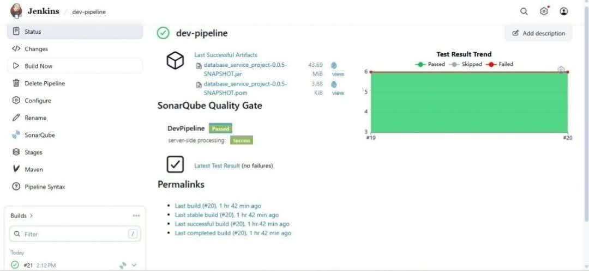

# Screenshots

Add your own screenshots to this folder and list them here, for example:

- `jenkins-pipeline-success.png` - all stages green in Jenkins
- `sonarqube-report.png` - SonarQube quality gate result
- `trivy-report.png` - Trivy scan output
- `eks-pods.png` - `kubectl get pods` on the EKS cluster
- `grafana-dashboard.png` - Prometheus and Grafana monitoring

